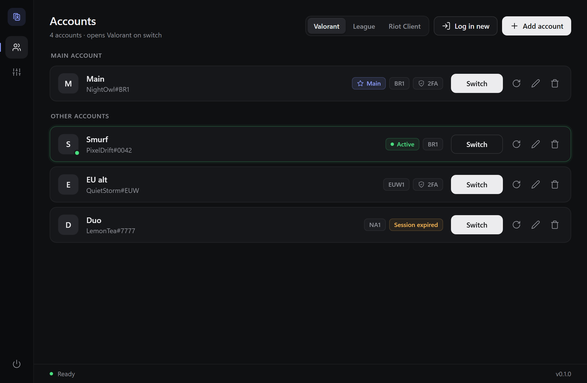
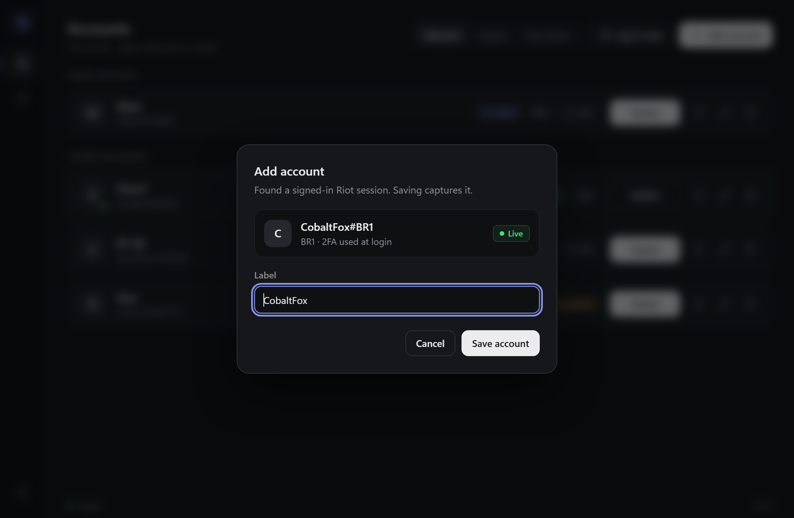
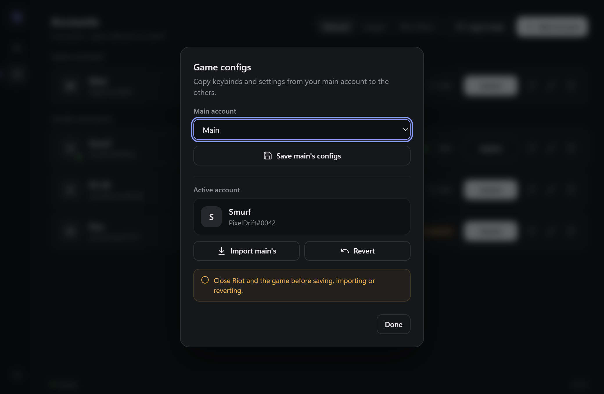
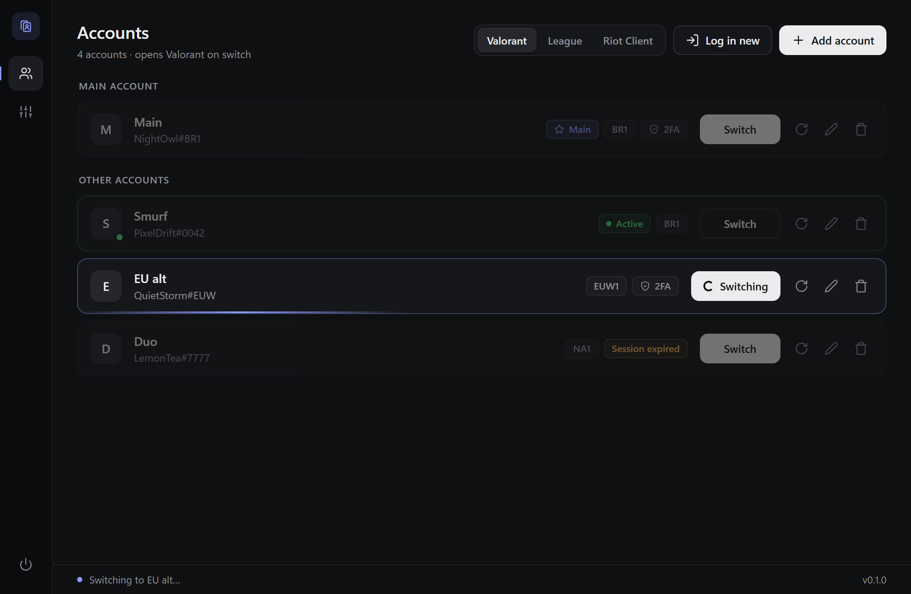
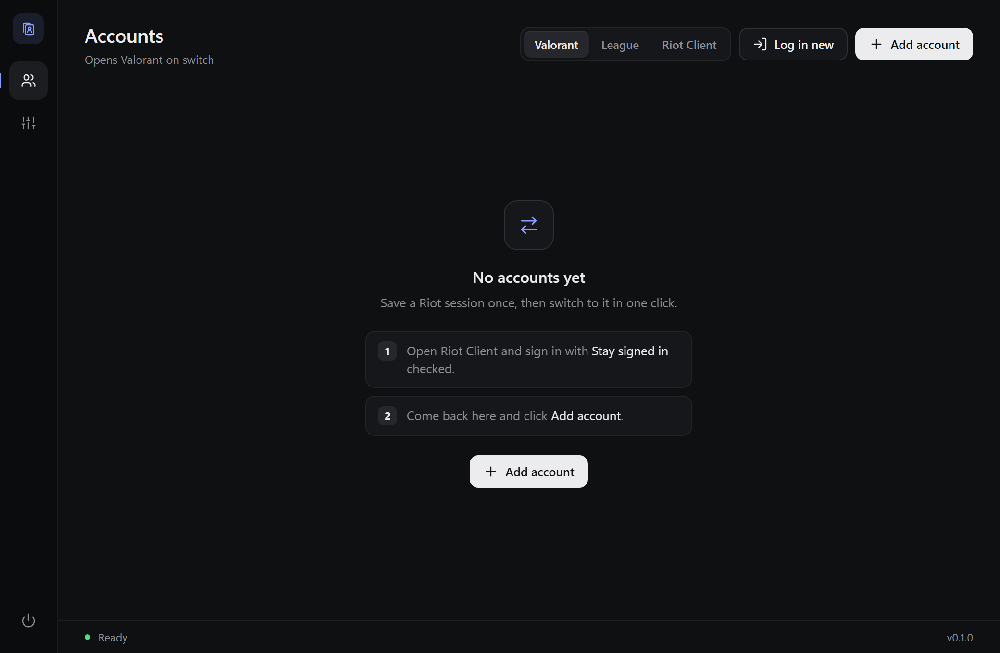

<div align="center">


# Alt Hop

**Switch between Riot accounts in one click — Valorant, League of Legends or just the Riot Client.**
No passwords stored, no login automation, no game memory touched.

[](https://github.com/giovaniohira/alt-hop/releases/latest)
[](https://github.com/giovaniohira/alt-hop/releases)


[](LICENSE)

[**Download**](https://github.com/giovaniohira/alt-hop/releases/latest) · [How it works](#how-it-works) · [FAQ](#faq)



</div>

## Features

- **One-click switch** — closes Riot, swaps the saved session in and reopens Valorant, League or the Riot Client.
- **Auto-detected identity** — Riot ID, region and whether 2FA was used are read from the session token itself. No API calls.
- **Session health** — accounts whose saved session is no longer valid get a *Session expired* badge; one click recaptures it.
- **Game config sync** — save your main account's Valorant/League settings (keybinds, crosshair, graphics) and copy them onto any alt, with a per-account backup so you can revert.
- **Tiny and native** — built with [Tauri 2](https://tauri.app) and plain HTML/CSS/JS. ~1.4 MB installer, no Electron.

<table>
  <tr>
    <td></td>
    <td></td>
  </tr>
  <tr>
    <td align="center"><sub>Adding an account picks up the signed-in Riot ID</sub></td>
    <td align="center"><sub>Copy your main's game settings to alts</sub></td>
  </tr>
  <tr>
    <td></td>
    <td></td>
  </tr>
  <tr>
    <td align="center"><sub>Switching</sub></td>
    <td align="center"><sub>First run</sub></td>
  </tr>
</table>

## Install

1. Grab `AltHop_x.y.z_x64-setup.exe` from the [latest release](https://github.com/giovaniohira/alt-hop/releases/latest).
2. Run it. Windows SmartScreen may warn because the installer isn't code-signed — click **More info → Run anyway**.
3. Open **Alt Hop** and accept the UAC prompt (see [why](#why-does-it-ask-for-administrator)).

Requires Windows 10/11 with WebView2 (preinstalled on Windows 11; the installer fetches it on Windows 10 if missing).

## Usage

1. Open the Riot Client and sign in with **Stay signed in** checked.
2. In Alt Hop click **Add account**, give it a label, save.
3. For the next account click **Log in new** — Riot reopens on the login screen. Sign in (again with *Stay signed in*) and click **Add account**.
4. From now on, click **Switch** on any account. Pick what opens after switching with the *Valorant / League / Riot Client* toggle.

**Copying game settings:** open the sliders icon on the left, choose your main account, click *Save main's configs* while logged into it. Later, switched into an alt, click *Import main's*. *Revert* puts the alt's previous configs back.

## How it works

The Riot Client keeps your "stay signed in" session in a single file:

```
%LOCALAPPDATA%\Riot Games\Riot Client\Data\RiotGamesPrivateSettings.yaml
```

Alt Hop copies that file per account when you add/recapture one, and on switch it:

1. saves the current file back over the departing account (Riot rotates tokens, so this keeps them fresh),
2. closes every Riot/Valorant/League process,
3. puts the target account's file in place,
4. starts `RiotClientServices.exe` with the product you chose.

That's it — no password handling, no talking to Riot's auth servers, no injection. Game configs work the same way: whole-folder copies of `%LOCALAPPDATA%\VALORANT\Saved\Config` and `C:\Riot Games\League of Legends\Config`.

App data lives in `%LOCALAPPDATA%\AltHop`:

| Path | What |
|---|---|
| `accounts.json` | labels, Riot IDs, regions |
| `settings.json` | launch target, active and main account |
| `sessions\<id>.yaml` | saved Riot session per account |
| `configs\principal\` | main account's game configs |
| `configs\backup\<id>\` | each account's configs before the last import |

## FAQ

### Can I get banned for using this?
Alt Hop doesn't touch the game, its memory or its network traffic, and doesn't automate the login screen. It only copies a file the Riot Client itself writes, then starts the client normally — the same thing as logging in and out by hand. That said, this is an unofficial tool and it isn't endorsed by Riot; use it at your own risk.

### Does it store my password?
No. You always type your password into the real Riot Client. Alt Hop only keeps a copy of the session file Riot creates after you log in.

### Is it safe to keep these session files?
Treat them like a password. Anyone who can read `%LOCALAPPDATA%\AltHop\sessions` on your PC can sign in as you until the session expires. They're stored as plain files, protected only by your Windows account. Don't use Alt Hop on a shared or public computer, and delete the folder if you stop using it.

### Why does it ask for administrator?
The Riot Client (with Vanguard) often runs elevated, and a non-elevated app can't close it. Alt Hop relaunches itself once with UAC so switching can stop Riot cleanly. If you decline, the app still opens but switching will fail.

### An account says "Session expired". What now?
Riot sessions eventually expire or get revoked (password change, "log out of all devices", long inactivity). Switch to that account, sign in again with *Stay signed in*, then click the **Recapture** (↻) button on its card.

### Does it work with 2FA?
Yes. You complete 2FA once when logging in; the saved session already counts as authenticated. The *2FA* badge just shows whether 2FA was used for that login.

### Does it work for League of Legends / TFT / Legends of Runeterra?
Switching works for anything that runs through the Riot Client, because the session is shared. The launch toggle has shortcuts for Valorant and League; pick *Riot Client* for anything else. Config sync covers Valorant and League.

### Will "Log in new" sign out my other accounts?
No. It only removes the local session file so Riot shows the login screen. Your other accounts' sessions are saved separately and stay valid on Riot's side.

### Config import messed up my settings.
Open the configs panel while switched into that account and click **Revert** — it restores the backup taken right before the import. Only the most recent import is kept per account.

### Does it work on macOS or Linux?
No. It's Windows-only, like Valorant.

### Is Alt Hop affiliated with Riot Games?
No. Alt Hop isn't endorsed by Riot Games and doesn't reflect the views or opinions of Riot Games or anyone officially involved in producing or managing Riot Games properties. Riot Games, Valorant and League of Legends are trademarks or registered trademarks of Riot Games, Inc.

## Building from source

Requirements: [Rust](https://rustup.rs), [Node.js](https://nodejs.org) 18+, and the [Tauri prerequisites](https://tauri.app/start/prerequisites/) for Windows.

```bash
npm install
npm run tauri dev     # run with hot reload
npm run tauri build   # installer in src-tauri/target/release/bundle/nsis/
```

Run the tests:

```bash
cargo test --manifest-path src-tauri/Cargo.toml
```

## Project layout

```
src/              frontend (vanilla HTML/CSS/JS)
src-tauri/src/    Rust backend: session swap, config sync, JWT identity parsing
docs/images/      README images
```

## License

[MIT](LICENSE)
